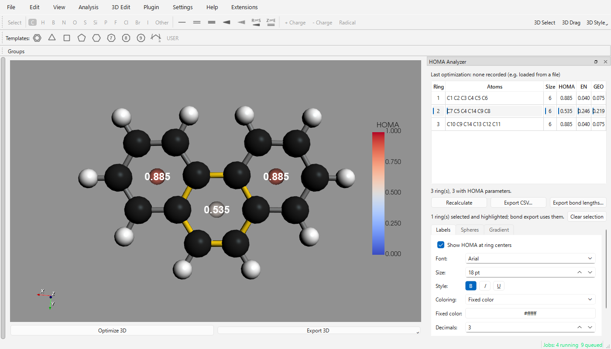

# HOMA Analyzer

[](https://github.com/HiroYokoyama/python_molecular_editor)
[](https://github.com/HiroYokoyama/moleditpy_homa_analyzer/actions/workflows/test.yml)

[](https://github.com/HiroYokoyama/moleditpy_homa_analyzer/tags)
[](https://github.com/HiroYokoyama/moleditpy_homa_analyzer/releases)


A [MoleditPy](https://github.com/HiroYokoyama/python_molecular_editor) plugin that computes the
**HOMA** (Harmonic Oscillator Model of Aromaticity) index of every ring in the 3D structure. It
labels each ring center in the 3D view, optionally with a sphere colored by HOMA, lists the rings
in a panel on the right, and exports the ring list and every ring bond length as CSV.



*Phenanthrene optimized with r2SCAN-3c in ORCA and loaded from the `.xyz` file, with gradient
spheres switched on. The middle ring is selected in the table and highlighted in 3D.*

## Usage

1. Build or load a structure and show it in 3D. Use a quantum-chemically optimized geometry (see
   [Geometry warning](#geometry-warning)).
2. Choose **Analysis ▸ HOMA Analyzer**. A panel opens on the right of the main window.
3. Read the values in the panel or at the ring centers in the 3D view. The panel recalculates
   automatically when the structure is redrawn or re-optimized. **Recalculate** forces it.
4. Select rows in the table to highlight those rings in 3D. **Clear selection** removes the
   selection.
5. **Export CSV...** saves the ring list. **Export bond lengths...** saves one row per ring bond,
   for the selected rings or, with nothing selected, for every ring.

| Column | Meaning |
| :--- | :--- |
| Ring | Ring number, also used for the 3D label |
| Atoms | Ring atoms in bonded order, with 1-based atom numbers |
| Size | Number of ring atoms |
| HOMA | The HOMA index; *n/a* when a ring bond has no parameters (the tooltip names it) |
| EN, GEO | The decomposition HOMA = 1 − EN − GEO, for rings whose bonds are all of one type |

Both CSV files start with the last optimization method and, if there is one, the geometry warning.
The ring list adds RDKit's aromaticity flag and the ring's bond lengths. The bond-length file lists
each bond's atoms, type, length, R<sub>opt</sub>, α and its term α(R<sub>opt</sub> − R)²/*n*, so
1 minus the sum of a ring's terms is its HOMA.

## 3D view options

The tabs under the table set what the 3D view shows. Changes apply immediately and are kept for
later sessions.

**Labels**

| Setting | Default |
| :--- | :--- |
| Show HOMA at ring centers | On |
| Font | Arial (any installed font) |
| Size | 18 pt |
| Style | **B**old on; *I*talic and <u>U</u>nderline off |
| Coloring | Fixed color, or HOMA gradient |
| Fixed color | White |
| Decimals | 3 (also used in the table and legend) |

**Spheres**

| Setting | Default |
| :--- | :--- |
| Show a sphere at ring centers | Off |
| Coloring | HOMA gradient, or fixed color |
| Fixed color | `#3070ff` |
| Radius | 0.30 Å |
| Opacity | 60 % |

**Gradient**

Labels and spheres that use the gradient share one colormap and range, so one legend describes
both.

| Setting | Default |
| :--- | :--- |
| Colormap | `coolwarm` (blue at the minimum, red at the maximum); the Mapped Cube Viewer's list |
| Range | 0 to 1. **Fit to rings** stretches it over the current values; **0 to 1** restores it. Values outside the range take the end colors. |
| Show legend | On, while anything uses the gradient |
| Legend title | HOMA |
| Orientation | Vertical |
| Tick labels | 5 |
| Legend font size | 14 pt |
| Legend text color | `#202020` |

Selected rings are traced with a yellow tube along their bonds.

## Geometry warning

HOMA is computed from bond lengths, so it is only as good as the geometry. The panel reads the
method MoleditPy recorded for the last successful optimization of the structure, and shows a
warning when that method is a force field (MMFF94, MMFF94s, UFF, GAFF, Ghemical, PMEFF or a
constrained force-field optimization) or when the structure was embedded without optimization.
Force fields reproduce conjugated bond lengths only roughly, which shifts HOMA noticeably. For
phenanthrene, r2SCAN-3c gives the middle ring HOMA 0.535; MMFF94s gives 0.788 and UFF 0.803. No
warning is shown for structures loaded from a file, or optimized by a quantum-chemical plugin.

The method is recognized by name: MMFF, UFF, GAFF, Ghemical, PMEFF and constrained optimizations,
which covers MoleditPy's own force fields and the Open Babel Optimizer and PMEFF plugins. A force
field added later by a plugin under another name is not recognized.

MoleditPy keeps the last method when a new structure is loaded, so the panel checks that the method
belongs to the structure on screen: MoleditPy's own optimizations tag the molecule they produce,
and any other method is tied to the structure that was current when it ran. A structure loaded
after an optimization therefore shows no warning.

## Method

For a ring of *n* bonds,

HOMA = 1 − (1/*n*) Σ α<sub>j</sub> (R<sub>opt,j</sub> − R<sub>i</sub>)²

where R<sub>i</sub> are the ring bond lengths and α<sub>j</sub>, R<sub>opt,j</sub> are the
parameters of the bond type *j*. HOMA is 1 for a ring whose bonds all have the optimal aromatic
length, and 0 for a hypothetical Kekulé structure. Negative values indicate antiaromatic or
strongly alternating rings.

Rings are RDKit's smallest set of smallest rings. Bond lengths come from the 3D coordinates,
including bonds that RDKit does not mark as aromatic.

### Parameters

| Bond | α | R<sub>opt</sub> (Å) |
| :--- | ---: | ---: |
| C–C | 257.7 | 1.388 |
| C–N | 93.52 | 1.334 |
| C–O | 157.38 | 1.265 |
| C–P | 118.91 | 1.698 |
| C–S | 94.09 | 1.677 |
| N–N | 130.33 | 1.309 |
| N–O | 57.21 | 1.248 |

These are the parameters of Krygowski (1993) [1], as tabulated in the review by Krygowski and
Szatyłowicz [3]. Rings containing any other bond (for example C–Si, B–N or C–Se) show *n/a*.

For rings whose bonds are all of one type, HOMA is split into an energetic and a geometric term
[2]:

EN = α (R<sub>opt</sub> − R<sub>av</sub>)², GEO = (α/*n*) Σ (R<sub>av</sub> − R<sub>i</sub>)²,
HOMA = 1 − EN − GEO

EN measures how far the mean bond length is from the optimal value, and GEO measures bond-length
alternation. For rings with mixed bond types, EN and GEO are left empty.

### Validation

The formula, every parameter, the EN/GEO split and the citations below were checked independently
against the literature and Crossref DOI records. The test suite reproduces the published value
for benzene with all C–C bonds at 1.397 Å: HOMA 0.979, EN 0.021, GEO 0.000 ([3], Table 4). It also
checks a B3LYP/def2-SVP benzene geometry from an ORCA optimization (all C–C 1.3991 Å), which gives
HOMA 0.968, EN 0.032 and GEO 0.000.

The tests also include two geometries optimized for this plugin with ORCA 6.1.1 at r2SCAN-3c:

| Molecule | Ring | HOMA | EN | GEO | Published [3], Table 4 |
| :--- | :--- | ---: | ---: | ---: | :--- |
| Naphthalene | each ring | 0.812 | 0.061 | 0.127 | 0.802 (EN 0.077, GEO 0.121) |
| Phenanthrene | outer rings | 0.885 | 0.040 | 0.075 | |
| Phenanthrene | middle ring | 0.535 | 0.246 | 0.219 | |

The naphthalene value is within 0.01 of the published one. Phenanthrene shows the expected pattern:
the outer rings are benzene-like and the middle ring is much less aromatic.

### References

1. Krygowski, T. M. Crystallographic Studies of Inter- and Intramolecular Interactions Reflected
   in Aromatic Character of π-Electron Systems. *J. Chem. Inf. Comput. Sci.* **1993**, *33* (1),
   70–78. <https://doi.org/10.1021/ci00011a011>
2. Krygowski, T. M.; Cyrański, M. Separation of the Energetic and Geometric Contributions to the
   Aromaticity of π-Electron Carbocyclics. *Tetrahedron* **1996**, *52* (5), 1713–1722.
   <https://doi.org/10.1016/0040-4020(95)01007-6>
3. Krygowski, T. M.; Szatyłowicz, H. Aromaticity: What Does It Mean? *ChemTexts* **2015**, *1* (3),
   12. <https://doi.org/10.1007/s40828-015-0012-2>
4. Krygowski, T. M.; Szatyłowicz, H.; Stasyuk, O. A.; Dominikowska, J.; Palusiak, M. Aromaticity
   from the Viewpoint of Molecular Geometry: Application to Planar Systems. *Chem. Rev.* **2014**,
   *114* (12), 6383–6422. <https://doi.org/10.1021/cr400252h>
5. Andrzejak, M.; Kubisiak, P.; Zborowski, K. K. Avoiding Pitfalls of a Theoretical Approach: The
   Harmonic Oscillator Measure of Aromaticity Index from Quantum Chemistry Calculations.
   *Struct. Chem.* **2013**, *24* (4), 1171–1184. <https://doi.org/10.1007/s11224-012-0148-2>

Reference [5] shows how strongly HOMA depends on the method used to obtain the geometry, which is
the reason for the [geometry warning](#geometry-warning).

## Installation

Install it from the Plugin Installer in MoleditPy, or copy the `homa_analyzer` folder into the
MoleditPy plugin directory. It needs no packages beyond MoleditPy itself
(NumPy, PySide6, PyVista and RDKit).

## Development

```bash
python -m pytest tests -v
```

The tests use RDKit, PySide6 (offscreen) and PyVista. The API test checks every host access against the
MoleditPy source when `python_molecular_editor` is checked out next to this repository.

## License

LGPL-3.0-or-later. See [LICENSE](LICENSE), [COPYING](COPYING) and [LICENSING.md](LICENSING.md).
